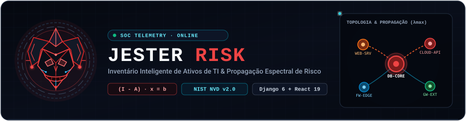
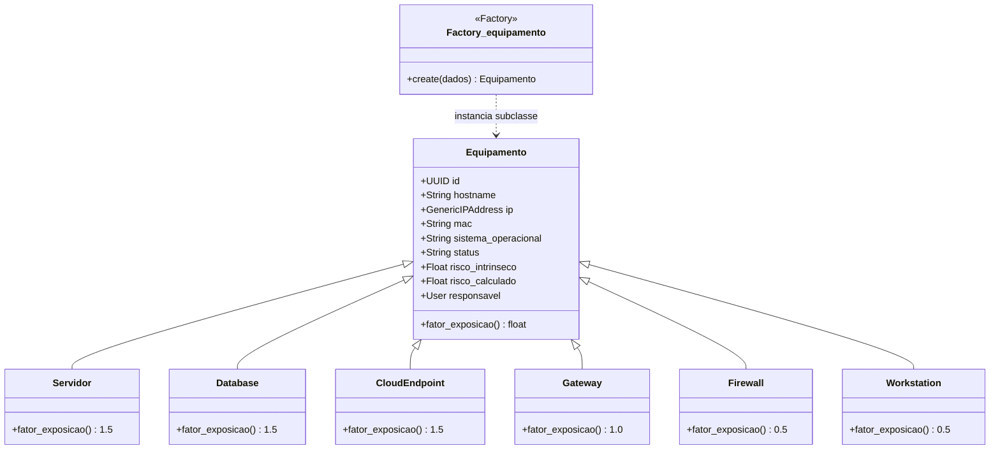
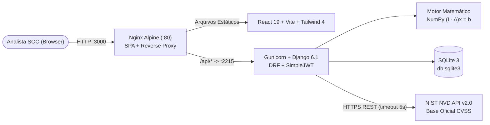

[ SOBRE O USO DE IA ]
arte do site foi criado primeiro com google flows usando sites reais do mercado de trabalho, desenhos feitos a mão e cores escolhidas por mim que eu considerei perfeitas para o sistema, ou seja o flows criou as imagens de exemplos.

Usando um prompt gerado pelo gemini mais as imagens geradas pelo flow eu pedi para que o google studio AI desse vida as imagens, ele criou todo o html e css sem tocar em nada do backend que foi uma das principais regras descritas no meu prompt.

Por fim usei o copilot pra debugar meu codigo e apontar todas as falhas que tiver.

o uso da IA foi utilizado somento pra gerar o frontend e e marcar falhas ou seja somente pra "maquiar a cara do app", backend, correção de bugs e etc foram feitos a mão

---

<p align="center">
  
</p>

<p align="center">
  
  
  
  
  
  
  
  
</p>

<p align="center">
  <b>Plataforma Full-Stack de Cibersegurança para Inventário Polimórfico de Ativos de TI, Enriquecimento Automático de CVEs (NIST NVD v2.0) e Modelagem Matemática de Propagação Lateral de Risco em Grafos de Rede.</b>
</p>


## 🛡️ Visão Geral — JESTER RISK

O **JESTER RISK** (*Jester Security Intelligence — Risk Propagation Model*) é uma plataforma web completa voltada a equipes de **SOC (Security Operations Center)**, Infraestrutura e Cibersegurança. O sistema unifica o gerenciamento de ativos computacionais com um **motor algébrico espectral** capaz de quantificar não apenas o risco isolado de uma máquina vulnerável, mas **como esse risco se propaga lateralmente pela topologia da rede corporativa**.

Ao cadastrar servidores, bancos de dados, endpoints em nuvem, gateways, firewalls e estações de trabalho, o analista modela as conexões reais entre os ativos (portas, protocolos, direcionalidade e peso de contágio) e vincula vulnerabilidades consultadas em tempo real na base oficial do **NIST (National Vulnerability Database — API v2.0)**. A cada alteração na rede ou no estado de uma CVE, o backend recalcula instantaneamente o sistema linear $(I - A) \cdot x = b$, atualizando os índices de criticidade e o mapa topológico interativo.


## ✨ Principais Funcionalidades

- **🔐 Autenticação Segura & Escopo por Responsável (JWT):**
  - Login via **SimpleJWT** (`access` e `refresh` tokens) com interceptor Axios no frontend para renovação transparente de sessão sem desconexão em *reload* (`F5`).
  - Vínculo direto de ativos ao usuário responsável (`User`), preparando a governança de superfície de ataque por analista/equipe.
- **🏭 Inventário Polimórfico de Ativos (POO + Factory Pattern):**
  - Especialização de ativos via herança multi-tabela no Django ORM (`Servidor`, `Database`, `CloudEndpoint`, `Gateway`, `Firewall`, `Workstation`), instanciados dinamicamente pela fábrica `Factory_equipamento`.
  - Conversão automática de convenções `snake_case` (Python/Django) $\leftrightarrow$ `camelCase` (TypeScript/React) na camada REST.
- **🧬 Gestão Híbrida de Vulnerabilidades (NIST NVD API v2.0):**
  - Consulta automatizada pelo código CVE (ex.: `CVE-2021-44228`) extraindo descrição oficial, **CVSS v3.1 / v2.0 Base Score**, severidade e vetor de ataque (`NETWORK`, `ADJACENT`, `LOCAL`).
  - **Fallback Resiliente:** Em ambientes isolados (sem internet), *timeout* da API externa ou CVEs internas/zero-day ainda não publicadas, o cadastro prossegue de forma 100% manual sem interromper a operação.
- **🕸️ Topologia Interativa & Simulação de Movimento Lateral:**
  - Grafo interativo em SVG com *zoom*, *pan*, inspeção de nós, criação de enlaces direcionados (`Outbound`, `Inbound`, `Bidirecional`) e bloqueio rápido de arestas críticas (`Ativa` / `Monitorada` / `Bloqueada`).
  - **Modo Simulação de Contágio:** Visualiza rotas de propagação lateral e impacto em cascata a partir de ativos comprometidos, além de diagnóstico rápido via *Ping Terminal* simulado.
- **📊 Telemetria Espectral no Dashboard SOC:**
  - Cálculo em tempo real do **Raio Espectral ($\lambda_{\max}$)**, **Densidade da Matriz de Adjacência ($\rho$)**, **Mapa de Calor ($A_{ij}$)** dos vetores de contágio e distribuição global de severidade de CVEs.


## 🧩 Orientação a Objetos & Polimorfismo

A criticidade estrutural de cada ativo não depende de uma *string* estática: o sistema utiliza **Herança Multi-Tabela** e **Polimorfismo** em `inventario/models.py`. Cada subclasse sobrescreve o método `fator_exposicao()`, calibrando matematicamente o peso intrínseco do nó de acordo com seu papel arquitetural na infraestrutura:



| Classe Especializada | Tipo na Interface | `fator_exposicao()` | Papel Arquitetural na Superfície de Ataque |
| :--- | :--- | :---: | :--- |
| `Servidor` | `Internal Server` | **`1.5x`** | Hospeda serviços críticos de aplicação; alto impacto em caso de comprometimento. |
| `Database` | `Database` | **`1.5x`** | Repositório central de dados sensíveis; alvo primário de exfiltração e *ransomware*. |
| `CloudEndpoint` | `Cloud Endpoint` | **`1.5x`** | Superfície exposta ou integrada a provedores externos e APIs em nuvem. |
| `Gateway` | `Gateway` | **`1.0x`** | Nó de roteamento e transição entre sub-redes internas e externas. |
| `Firewall` | `Firewall` | **`0.5x`** | Ativo endurecido (*hardened*) dedicado à filtragem e contenção de perímetro. |
| `Workstation` | `Workstation` | **`0.5x`** | Estação de usuário final com escopo local reduzido frente a servidores centrais. |


## 📐 Motor Matemático de Propagação Espectral

Implementado em `inventario/motor_matematico.py` com **NumPy**, o motor modela a infraestrutura de TI como um grafo direcionado ponderado $G = (V, E)$, onde $|V| = n$ ativos.

### 1. Vetor de Risco Intrínseco ($b \in \mathbb{R}^n$)
Para cada ativo $i \in \{1, \dots, n\}$, soma-se a pontuação CVSS de todas as vulnerabilidades **ativas** (não mitigadas) multiplicada pelo fator polimórfico de exposição da sua subclasse $f_{\text{exp}}(i)$:

$$
b_i = \left( \sum_{v \in \text{CVEs}(i)} \text{CVSS}_v \right) \cdot f_{\text{exp}}(i)
$$

### 2. Matriz de Adjacência e Propagação ($A \in \mathbb{R}^{n \times n}$)
Cada conexão ativa (`status != "Bloqueada"`) entre dois ativos possui um peso de propagação $w \in [0, 1]$:
- **`Outbound`** ($i \to j$): $A_{ij} = w$
- **`Inbound`** ($j \to i$): $A_{ji} = w$
- **`Bidirecional`** ($i \leftrightarrow j$): $A_{ij} = A_{ji} = w$

### 3. Resolução do Risco Propagado ($x \in \mathbb{R}^n$)
O risco efetivo $x_i$ de um ativo incorpora tanto suas falhas locais ($b_i$) quanto o risco herdado recursivamente dos seus vizinhos na rede ($A \cdot x$), formando a série de Neumann convergida no sistema linear:

$$
x = b + A x \implies (I - A) \cdot x = b
$$

O backend resolve o sistema exato via decomposição LU em `numpy.linalg.solve(np.eye(n) - A, b)`. Caso a topologia gere uma matriz singular ($\det(I - A) = 0$), o motor aciona automaticamente um *fallback* seguro preservando o vetor intrínseco $b$.

### 4. Métricas Espectrais de Governança ($\lambda_{\max}$ e $\rho$)
Para avaliar a resiliência estrutural da rede como um todo, o endpoint `/api/metrics/` extrai os autovalores de $A$:

$$
\lambda_{\max}(A) = \max_{1 \le k \le n} |\lambda_k|, \qquad \rho(A) = \frac{\text{nnz}(A)}{n^2}
$$

> [!IMPORTANT]
> Quando $\lambda_{\max}(A) < 1$, a propagação de risco na rede converge matematicamente de forma estável. Valores próximos ou superiores a $1$ alertam o SOC sobre ciclos densos de movimento lateral que exigem segmentação imediata (bloqueio de arestas ou *firewalls* internos).


## 🏗️ Arquitetura Full-Stack & Containers

Em produção (incluindo implantação remota via SSH), toda a comunicação externa ocorre pela porta do **Nginx**, que serve o *bundle* otimizado do React e atua como **Reverse Proxy** para o **Gunicorn/Django** através da rede interna do Docker, eliminando bloqueios de firewall em portas secundárias e problemas de CORS:




## 📂 Estrutura do Repositório

```text
📁 Inventario-Ativos-TI/
├── 📄 docker-compose.yml          # Orquestração Full-Stack (Backend Gunicorn + Frontend Nginx)
├── 📄 Dockerfile                  # Imagem Python 3.12-slim para a API Django
├── 📄 entrypoint.sh               # Migrações automáticas, seed de superusuário e boot do Gunicorn
├── 📄 manage.py                   # Utilitário administrativo do Django
├── 📄 requirements.txt            # Dependências Python (Django, DRF, SimpleJWT, NumPy, Gunicorn...)
│
├── 📁 docs/assets/                # Banners e divisores vetoriais animados (SVG SMIL)
│
├── 📁 projeto_inventario/         # Configurações globais do projeto Django
│   ├── 📄 settings.py             # CORS, DRF CamelCase, SimpleJWT e variáveis de ambiente
│   └── 📄 urls.py                 # Roteamento raiz (/admin, /api/token/, /api/...)
│
├── 📁 inventario/                 # Core do Backend (Domínio, IA Matemática e API REST)
│   ├── 📄 models.py               # Herança polimórfica de Equipamento, Factory, Vulnerabilidade e ConexaoRede
│   ├── 📄 motor_matematico.py     # Cálculo vetorial (I - A)x = b com NumPy
│   ├── 📄 cve_service.py          # Cliente HTTP para a API NIST NVD v2.0 com tratamento de falhas
│   ├── 📄 serializers.py          # Serializers DRF, ResponsavelField e mapeamento topológico
│   ├── 📄 views.py                # Endpoints REST de ativos, CVEs, conexões, ping e métricas espectrais
│   └── 📄 urls.py                 # Rotas específicas do domínio de inventário
│
└── 📁 frontend/                   # Aplicação SPA (React 19 + TypeScript + Tailwind CSS 4)
    ├── 📄 Dockerfile              # Build multi-stage (Node 20 Alpine -> Nginx Alpine)
    ├── 📄 nginx.conf              # Roteamento SPA + Reverse Proxy /api/ -> http://backend:2215/api/
    └── 📁 src/
        ├── 📁 api/                # Cliente Axios com injeção JWT e fila de refresh automático (401)
        ├── 📁 components/         # Grafo SVG interativo (TopologyGraph), Modais, Sidebar, JesterLogo
        ├── 📁 pages/              # Login, Dashboard Espectral, Lista/Detalhes de Ativos, Topologia
        └── 📁 types/              # Contratos TypeScript sincronizados com os Serializers do backend
```


## 🔌 Principais Endpoints da API REST

Todos os endpoints (exceto obtenção/renovação de token) exigem cabeçalho `Authorization: Bearer <access_token>`.

| Método | Endpoint | Descrição |
| :---: | :--- | :--- |
| `POST` | `/api/token/` | Autentica credenciais e retorna o par de tokens JWT (`access` e `refresh`). |
| `POST` | `/api/token/refresh/` | Renova o `access` token expirado a partir de um `refresh` token válido. |
| `GET` | `/api/metrics/` | Retorna raio espectral ($\lambda_{\max}$), densidade ($\rho$), matriz de calor $A_{ij}$ e contadores CVSS. |
| `GET` `POST` | `/api/equipamentos/` | Lista os ativos sob responsabilidade do usuário ou instancia um novo ativo via `Factory_equipamento`. |
| `GET` `PATCH` `DELETE` | `/api/equipamentos/<uuid>/` | Consulta detalhes completos, atualiza atributos ou remove um ativo recalculando a rede. |
| `POST` | `/api/equipamentos/<uuid>/cves/` | Vincula uma CVE consultando automaticamente a NIST NVD API v2.0 (com *fallback* manual) e recalcula $(I - A)x = b$. |
| `DELETE` | `/api/equipamentos/<uuid>/cves/<cve_code>/` | Remove uma vulnerabilidade do ativo e recalcula o risco propagado da malha. |
| `POST` | `/api/equipamentos/<uuid>/connections/` | Cria um enlace de rede (`Outbound`, `Inbound` ou `Bidirecional`) com peso de propagação. |
| `PATCH` `DELETE` | `/api/equipamentos/<uuid>/connections/<id>/` | Altera o status da conexão (ex.: isolar/bloquear rota lateral) ou exclui a aresta. |
| `POST` | `/api/equipamentos/<uuid>/ping/` | Executa diagnóstico de conectividade, latência e portas abertas a partir das conexões ativas. |


## 🚀 Como Executar o Projeto

### Opção 1 — Com Docker Compose (Recomendado)

Ideal para rodar todo o ecossistema com um único comando, tanto localmente quanto em servidores remotos via SSH.

```bash
# 1. Clone o repositório
git clone https://github.com/SmokyyeSZ/Inventario-Ativos-TI.git
cd Inventario-Ativos-TI

# 2. Construa as imagens e suba os containers em background
docker compose up -d --build
```

- **Interface Web (Frontend + Proxy API):** acesse `http://localhost:3000`
- **Credenciais iniciais geradas automaticamente pelo `entrypoint.sh`:**
  - **Usuário:** `igor`
  - **Senha:** `senha123`
- Para criar um novo usuário administrador personalizado dentro do container:
  ```bash
  docker compose exec backend python manage.py createsuperuser
  ```

---

### Opção 2 — Execução Local (Ambiente de Desenvolvimento)

#### 1. Backend (Django + NumPy)

```bash
# Na raiz do repositório, crie e ative o ambiente virtual
python -m venv venv

# Windows (PowerShell)
.\venv\Scripts\Activate.ps1
# Linux / macOS
source venv/bin/activate

# Instale as dependências e aplique as migrações
pip install -r requirements.txt
python manage.py migrate

# Crie seu usuário de acesso e inicie o servidor na porta 8000
python manage.py createsuperuser
python manage.py runserver
```

#### 2. Frontend (React + Vite)

Em um segundo terminal:

```bash
cd frontend
npm install
npm run dev
```

Acesse o endereço exibido pelo Vite (por padrão `http://localhost:5173`), que se conectará automaticamente ao backend local em `http://localhost:8000/api/`.


<p align="center">
  Desenvolvido para estudos avançados de <b>Programação Orientada a Objetos, Arquitetura Full-Stack e Cibersegurança Quantitativa</b>.<br/>
  <sub>JESTER RISK · Security Intelligence &amp; Spectral Risk Propagation</sub>
</p>
